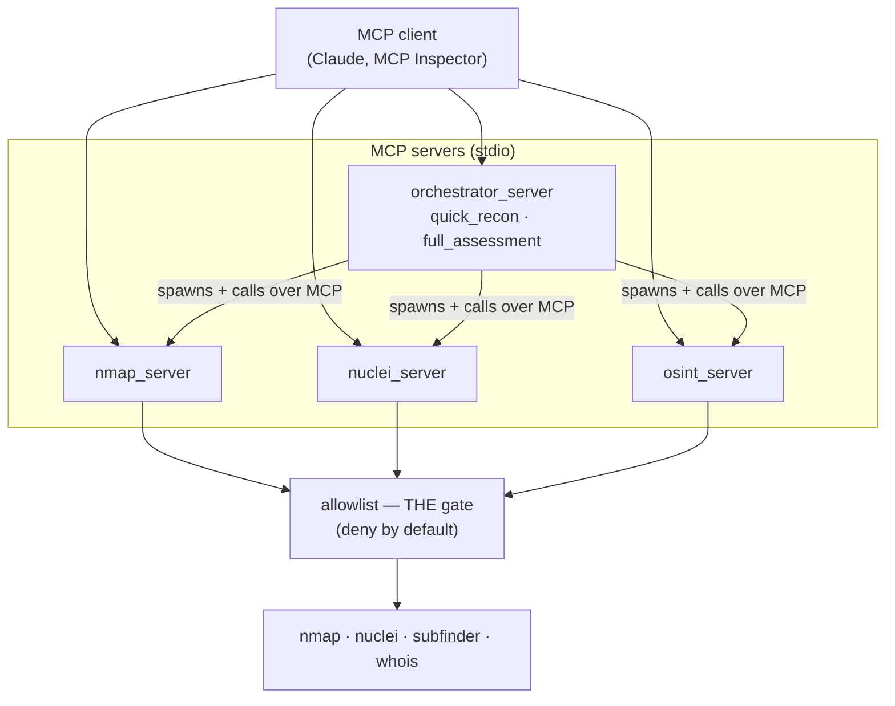

# mcp-recon-orchestrator

A safety-first [Model Context Protocol](https://modelcontextprotocol.io) (MCP)
toolkit that exposes network reconnaissance tools — nmap, nuclei, and passive
OSINT — to AI agents, with **every action gated behind a strict target
allowlist**. The authorization check is the one thing the toolkit cannot skip.

> ⚠️ **Authorized targets only.** By default it refuses every target except
> loopback, a Docker lab network you run yourself, and a DuckDNS subdomain you
> configure. Scanning systems without permission is illegal in most
> jurisdictions — the allowlist exists to keep you on the right side of it.

<!-- Demo GIF goes here once recorded:  -->
*An LLM (Claude) drives the orchestrator over MCP: it discovers the tools, runs
`quick_recon` on an authorized host, and is refused when it targets one that is
not on the allowlist — see [Demo](#demo).*

## How it works

The hard part isn't running `nmap` — it's giving an agent recon powers that are
**impossible to point at the wrong thing**. Everything routes through one
function, `assert_authorized`, which is **deny-by-default** and matches
hostnames exactly. Spoofs like `localhost.evil.com`, `127.0.0.1@evil.com`, and
the encoded `2130706433` are all refused, and it never resolves DNS to decide
(closing the DNS-rebinding TOCTOU hole).



The orchestrator is itself an **MCP client** of the three leaf servers: each
workflow spawns them and calls their tools over stdio, so the servers genuinely
compose with one another. A refusal or a missing scanner comes back as a
structured `authorized=false` / `error` envelope rather than an opaque error.

## Tools

| Server | Tool | Purpose |
| --- | --- | --- |
| nmap | `port_scan` / `service_detect` | Open TCP ports; service & version detection |
| nuclei | `vuln_scan` | Template-based vuln scan of a web target |
| osint | `find_subdomains` / `dns_records` / `whois_lookup` | Passive OSINT |
| orchestrator | `quick_recon` / `full_assessment` | Chains the leaf servers over MCP |

## Configuration

Loopback is always allowed; everything else is opt-in (see `.env.example`):

| Variable | Example | Meaning |
| --- | --- | --- |
| `RECON_ALLOWED_HOSTS` | `mylab.duckdns.org` | Exact hostnames to authorize |
| `RECON_ALLOWED_NETWORKS` | `172.28.0.0/16` | IPs/CIDRs to authorize |

## Quickstart

```bash
uv sync --dev                                      # install
uv run pytest                                      # 92 unit tests, no scanners needed
uv run mcp dev src/recon/servers/orchestrator_server.py   # inspect tools by hand
```

A project-scoped [`.mcp.json`](.mcp.json) is included, so any MCP client that
reads it (e.g. [Claude Code](https://claude.com/claude-code): run `claude` and
approve the server) can load the orchestrator and drive it in natural language.

### Docker lab

OWASP Juice Shop (intentionally vulnerable) plus the toolkit on a private
network — Juice Shop is never published to the host, and the allowlist is scoped
to the lab.

```bash
docker compose up -d --build
docker compose exec recon pytest -m integration   # real nmap/nuclei scans
```

## Demo

With the orchestrator loaded in an MCP client, ask it in plain language:

1. *"What recon tools do you have, and what's the safety model?"*
2. *"Run a quick recon on localhost and summarize the findings."*
3. *"Now do the same for example.com."* → the allowlist refuses it, and the
   agent explains why.

Step 3 is the point: the agent is capable, but one authorization gate keeps it
in its lane.
