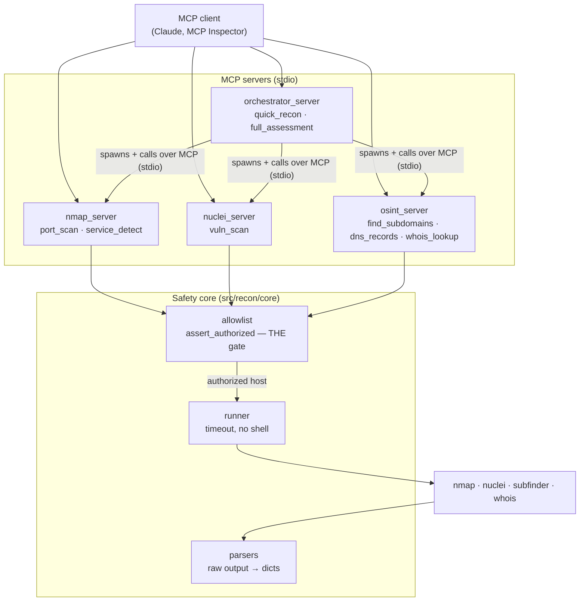

# mcp-recon-orchestrator

A safety-first [Model Context Protocol](https://modelcontextprotocol.io) (MCP)
toolkit that exposes network reconnaissance tools — nmap, nuclei, and passive
OSINT — to AI agents, with every action gated behind a strict **target
allowlist**. The toolkit is built so that the authorization check is the one
thing it cannot skip.

> ## ⚠️ Authorized targets only
> This project is for scanning systems **you own or are explicitly authorized
> to test**. By default it refuses every target except loopback, a Docker lab
> network you run yourself, and a single DuckDNS subdomain you configure.
> Scanning systems without permission is illegal in most jurisdictions. The
> allowlist exists to keep you on the right side of that line — do not remove
> it.

<!-- Demo GIF goes here once recorded:  — see the "Demo" section. -->
*An LLM (Claude) drives the orchestrator over MCP: it discovers the tools, runs
`quick_recon` on an authorized host, and is refused when it targets one that is
not on the allowlist. See [Demo](#demo).*

---

## Why it exists

Giving an LLM a shell that can run `nmap` is easy and reckless. The interesting
engineering problem is giving it recon capabilities that are **impossible to
point at the wrong thing**. Everything in this repo is organized around that
single guarantee:

- One authorization function, `assert_authorized`, is the only way a target
  reaches a scanner.
- It is **deny-by-default** and matches hostnames exactly, so tricks like
  `localhost.evil.com`, `127.0.0.1@evil.com`, or the decimal encoding
  `2130706433` are refused.
- It never resolves DNS to make the decision, which closes the DNS-rebinding
  time-of-check/time-of-use hole.

## Architecture



The orchestrator is itself an **MCP client** of the three leaf servers: each
workflow spawns them as subprocesses and calls their tools over stdio (see
`src/recon/orchestration/client.py`). So the servers really do talk to each
other — the orchestrator is a server to its client and a client to the other
three. Every leaf tool follows the same path: **authorize → run (with
timeout, no shell) → parse → return a consistent envelope.** A refusal or a
missing scanner comes back as a structured `authorized=False` / `error`
envelope, so it stays readable over the wire instead of surfacing as an
opaque protocol error.

## Layout

```
src/recon/
  core/
    allowlist.py   # deny-by-default target authorization (the safety core)
    runner.py      # subprocess wrapper: mandatory timeout, argument list only
    parsers.py     # nmap XML / nuclei JSONL / subfinder / whois → dicts
  servers/
    nmap_server.py          # port_scan, service_detect
    nuclei_server.py        # vuln_scan
    osint_server.py         # find_subdomains, dns_records, whois_lookup
    orchestrator_server.py  # quick_recon, full_assessment (MCP client of the above)
  orchestration/
    client.py      # spawns a leaf server over stdio and calls its tools
tests/             # 92 unit tests + integration tests for the Docker lab
```

## Tools

| Server | Tool | Purpose |
| --- | --- | --- |
| nmap | `port_scan(target, ports)` | Open TCP ports on an authorized host |
| nmap | `service_detect(target, ports)` | Service products/versions (`-sV`) |
| nuclei | `vuln_scan(target, port, scheme, severity)` | Template-based vuln scan of a web target |
| osint | `find_subdomains(domain)` | Passive subdomain enumeration (subfinder) |
| osint | `dns_records(domain, record_types)` | Resolve A/AAAA/MX/NS/TXT/CNAME |
| osint | `whois_lookup(domain)` | Registration details |
| orchestrator | `quick_recon(target)` | Open ports + DNS in one call |
| orchestrator | `full_assessment(target)` | Chains port scan → service detect → vuln scan → OSINT |

## Configuration

The allowlist always permits loopback. Everything else is opt-in via
environment variables (see `.env.example`):

| Variable | Example | Meaning |
| --- | --- | --- |
| `RECON_ALLOWED_HOSTS` | `mylab.duckdns.org,juiceshop` | Exact hostnames to authorize |
| `RECON_ALLOWED_NETWORKS` | `172.28.0.0/16,192.168.56.10` | IPs/CIDRs to authorize |

## Quickstart

```bash
# Install (uv recommended)
uv sync --dev

# Run the unit tests
uv run pytest

# Run an MCP server over stdio
uv run python -m recon.servers.orchestrator_server
```

### Use with an MCP client (e.g. Claude Desktop)

Add a server to your client's MCP config. Example entry:

```json
{
  "mcpServers": {
    "recon-orchestrator": {
      "command": "uv",
      "args": ["run", "python", "-m", "recon.servers.orchestrator_server"],
      "cwd": "/path/to/mcp-recon-orchestrator",
      "env": {
        "RECON_ALLOWED_HOSTS": "mylab.duckdns.org",
        "RECON_ALLOWED_NETWORKS": "172.28.0.0/16"
      }
    }
  }
}
```

### Inspect the tools by hand

```bash
# Launches the MCP Inspector against a server for manual tool calls
uv run mcp dev src/recon/servers/orchestrator_server.py
```

## The Docker lab

A self-contained, isolated lab: OWASP Juice Shop (intentionally vulnerable)
plus the toolkit, on a private bridge network. Juice Shop is **not** published
to the host.

```bash
docker compose up -d --build

# Run the integration scans against the lab
docker compose exec recon pytest -m integration

# Or drive a server over stdio from inside the lab
docker compose exec recon python -m recon.servers.nmap_server
```

The `recon` container's allowlist is scoped to `juiceshop` and `172.28.0.0/16`,
so even inside the lab the scanners cannot reach anything else.

## Testing

Four levels, matching how the project is meant to be trusted:

1. **Unit tests** (`uv run pytest`) — 92 tests, no external tools needed. The
   allowlist suite doubles as the security spec, and `test_client.py` spawns
   real leaf servers to prove the inter-server MCP path works.
2. **Integration scans** (`docker compose exec recon pytest -m integration`) —
   real nmap/nuclei against Juice Shop.
3. **MCP Inspector** — manual tool calls via `uv run mcp dev ...`.
4. **Agent demo** — drive `full_assessment` from an MCP client and capture the
   result for `assets/demo.gif`.

## Demo

The repo ships a project-scoped [`.mcp.json`](.mcp.json) that registers the
orchestrator with any MCP client that reads it (Claude Code, among others):

```json
{
  "mcpServers": {
    "recon-orchestrator": {
      "command": "uv",
      "args": ["run", "python", "-m", "recon.servers.orchestrator_server"]
    }
  }
}
```

With [Claude Code](https://claude.com/claude-code), from the project root:

```bash
claude            # approve the "recon-orchestrator" server when prompted
```

Then drive it in natural language — the LLM discovers the tools and decides
when to call them:

1. *"What recon tools do you have, and what's the safety model?"* — Claude
   lists `quick_recon` / `full_assessment` and surfaces the allowlist.
2. *"Run a quick recon on localhost and summarize the findings."* — Claude
   calls `quick_recon`, which chains the leaf servers over MCP.
3. *"Now do the same for example.com."* — the allowlist refuses it
   (`authorized: false`) and Claude explains why it won't scan.

Step 3 is the point: the agent is capable, but a single authorization gate
keeps it inside its lane. Record the exchange and save it as
`assets/demo.gif`.

## License

MIT — see [LICENSE](LICENSE).
